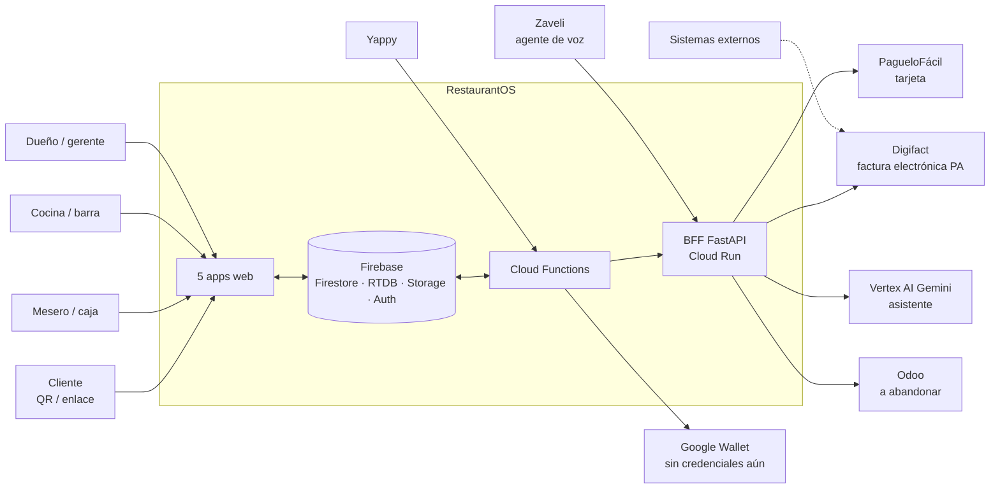
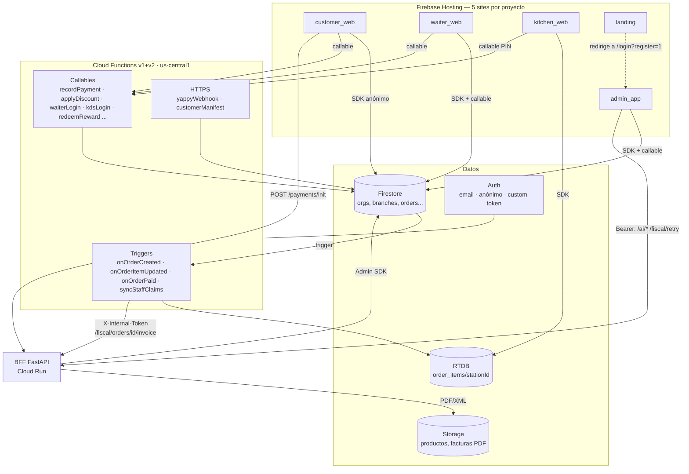
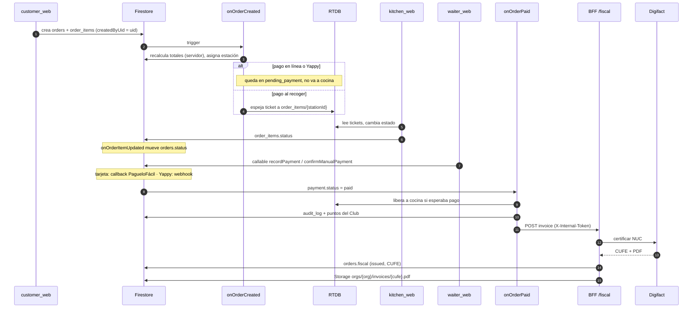
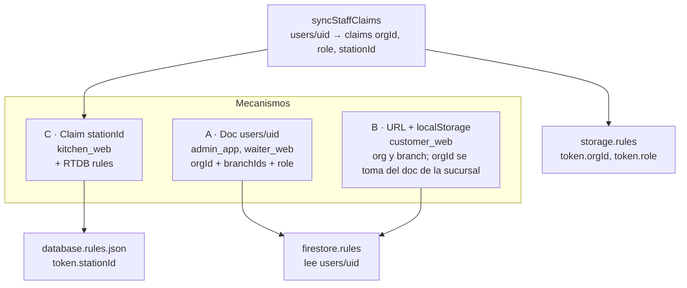
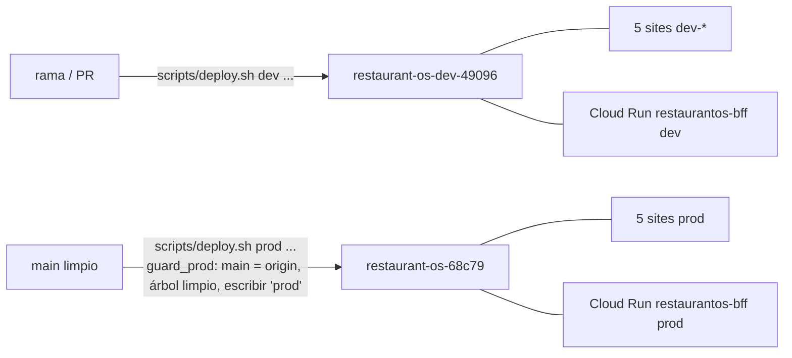
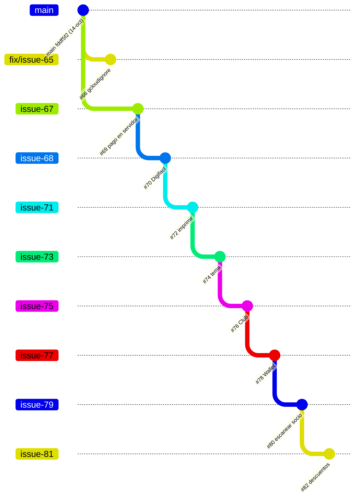
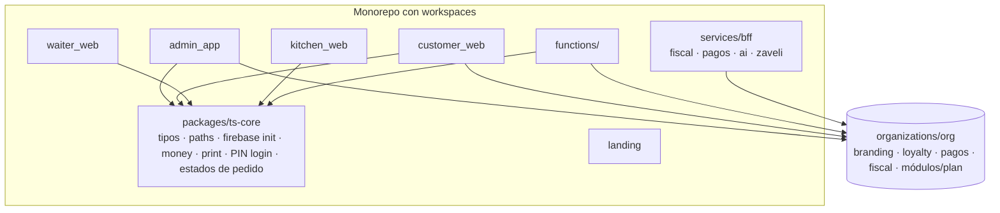

# Diagnóstico de plataforma RestaurantOS — noviembre 2026

Fecha: 2026-11-05. Rama: `feat/issue-81-descuentos`. Alcance: todo el monorepo (apps web, Flutter, Cloud Functions, BFF, reglas, scripts, docs).
Método: lectura de código por tres pasadas en paralelo (web, backend/infra, Flutter+docs) y verificación de los puntos críticos (estado de PRs vía GitHub, `git diff`, líneas citadas). No se ejecutó ni cambió código.

Decisiones tomadas por el dueño del producto al encargar este diagnóstico:

- **Mercado:** Panamá primero. Se diseñan interfaces para otros países pero no se construyen todavía.
- **Odoo:** se abandona.
- **Objetivo:** dejar de resolver cliente por cliente y tener un producto multi-restaurante vendible, con dev y prod ordenados.

---

## 1. Resumen ejecutivo

1. **El producto real hoy** son cinco apps web React (`admin_app`, `customer_web`, `waiter_web`, `kitchen_web`, `landing`), 25 Cloud Functions y un BFF FastAPI, todo sobre Firebase con dos proyectos (dev y prod). La base es sólida: reglas con validación de campos, totales calculados en servidor, un único punto de "pago confirmado", factura electrónica Digifact y 73 tests automatizados en backend.
2. **Los cuatro paquetes Flutter están abandonados** (`packages/core`, `client_app`, `waiter_app`, `kitchen_app`), y `waiter_demo` es un prototipo muerto que guarda email y contraseña en `localStorage` con la config de producción. Ninguno tiene hosting. `client_app` ni siquiera funcionaría contra las reglas nuevas.
3. **Riesgo mayor: prod está atrás de dev por ocho PRs apilados sin mergear.** `main` quedó en 2026-10-14 (`fddf5f2`). La rama actual tiene 24 commits y 122 archivos (+7.241 / −371) sobre `main`. Todo lo hecho desde entonces (pago en servidor, reglas nuevas, Digifact, Club, descuentos) existe solo en dev. Mientras más tarde el merge, más caro se vuelve.
4. **Segundo riesgo: no hay CI, ni tests en ninguna app web, ni paquete TypeScript compartido.** Cada app web copia su propio init de Firebase, rutas, tipos y utilidades, con versiones de React/Vite/Firebase distintas.
5. **Tercer riesgo: lo que parece multi-tenant a medias.** Aislamiento de datos por organización existe y funciona. Pero marca, programa de lealtad, Wallet y manifest están fijos para Pick & Eat. Eso bloquea vender a un segundo restaurante.
6. **La documentación miente.** `CLAUDE.md`, `README`, `ARCHITECTURE.md` y `ROADMAP.md` presentan Flutter y Odoo como el sistema vivo. Solo `AGENTS.md` coincide con el código.

**Veredicto:** el núcleo se salva y vale la pena. No hace falta reescribir. Hace falta (a) mergear lo pendiente, (b) podar lo muerto, (c) extraer lo duplicado, (d) mover lo específico de cliente a configuración por organización, (e) poner CI. Hoja de ruta en §8.

---

## 2. Inventario

### 2.1 Apps y servicios vivos

| Componente | Para quién | Stack | Tamaño | Hosting / deploy | Auth | Veredicto |
|---|---|---|---|---|---|---|
| `admin_app` | Dueños y gerentes | React 19, Vite 8, TS 5.9, Tailwind 4, TanStack Router/Query, Firebase 12 | 68 archivos, ~9,5k LOC | target `admin` (site por defecto de cada proyecto) | email/clave; rol admin/manager vía doc `users` (`use-auth.ts:53`) | **Mantener.** Único con lint y `tsc -b`. |
| `customer_web` | Cliente final (QR, pickup, Club) | React 18, Vite 5, Tailwind 3, Firebase 10 | 31 archivos, ~2,8k LOC | `restaurant-os-pedir` / `restaurant-os-dev-pedir` | anónima | **Mantener**, sacar la marca fija. |
| `waiter_web` | Mesero / caja | React 18, Vite 5, Tailwind 3, Firebase 10, jsqr | 23 archivos, ~2,3k LOC | `restaurant-os-mesero` / `-dev-mesero` | email o PIN con custom token | **Mantener.** |
| `kitchen_web` | Cocina / barra (KDS) | React 18, Vite 5, Firebase 10 | 11 archivos, ~700 LOC | `restaurant-os-cocina` / `-dev-cocina` | PIN de estación con custom token | **Mantener.** Sin typecheck en el build. |
| `landing` | Ventas | React 18, Tailwind 3 (sin Firebase) | 5 archivos, ~570 LOC | `restaurant-os-inicio` / `-dev-inicio` | n/a | **Mantener**; el checkout es simulado. |
| `functions/` | Backend en tiempo real | Node 22, firebase-functions 5, us-central1 | 25 exports | `firebase deploy --only functions` | claims `orgId/role/stationId` vía `syncStaffClaims` | **Mantener.** Es el motor operacional. |
| `apps/fastapi_bff` | Integraciones | Python 3.12, FastAPI, Cloud Run `restaurantos-bff` | 8 archivos de test, 55 tests | `scripts/deploy-bff.sh` | Bearer de Firebase / `X-Internal-Token` / HMAC | **Reorganizar** (ver §5). |
| Reglas | Seguridad de datos | `firestore.rules`, `database.rules.json`, `storage.rules` | | `scripts/deploy.sh <env> rules` | | **Mantener**; reglas bien diseñadas. |

### 2.2 Abandonado o sin valor

| Componente | Evidencia | Veredicto |
|---|---|---|
| `packages/core` (Dart) | Último commit 2026-05-06; solo lo usan las apps Flutter | Archivar |
| `apps/client_app` | Reemplazada por `customer_web` (AGENTS.md:69,76). No escribe `createdByUid`, que las reglas nuevas exigen (`firestore.rules:108-110,126`). Apunta a un túnel ngrok muerto | Archivar |
| `apps/waiter_app` | Congelada (AGENTS.md:78). Depende de `/auth/login` contra Odoo. Bundle ID duplicado con `client_app` | Archivar |
| `apps/kitchen_app` | Último cambio de código 2026-03-30. `kitchen_web` es el KDS principal (AGENTS.md:77) | Archivar |
| `apps/waiter_demo` | Un HTML de 942 líneas, config de **prod** embebida (líneas 403-410), credenciales en claro en `localStorage` (445-455). Sin hosting | **Borrar** |
| `apps/admin`, `apps/client`, `apps/kitchen` | Solo `SPEC.md` de abril; `client` y `kitchen` describen apps Flutter | Mover a `docs/archive/` |
| `docs/PENDING_FLUTTER_CHANGES.md`, `ORCHESTRATOR.md` | Obsoletos | Archivar |

Flutter no está instalado en esta máquina, así que no se pudo comprobar si algo de lo anterior compila. No cambia el veredicto: ninguno tiene destino de despliegue ni usuarios.

### 2.3 Dónde está el esfuerzo (commits últimos 3 meses, contando ramas apiladas)

| Directorio | Commits | Último |
|---|---|---|
| admin_app | 26 | 2026-10-24 |
| functions | 22 | 2026-10-24 |
| waiter_web | 20 | 2026-10-24 |
| customer_web | 12 | 2026-10-24 |
| fastapi_bff | 8 | 2026-10-24 |
| kitchen_web | 5 | 2026-09-29 |
| landing | 2 | 2026-09-29 |
| Flutter (los 4) | 1 (cosmético) | 2026-10-14 |

---

## 3. Diagramas

### 3.1 Contexto del sistema

### 3.2 Contenedores y protocolos

### 3.3 Ciclo de vida de un pedido

Observación: hay **cuatro caminos** que llegan a `payment.status = paid` (cobro del mesero, Yappy manual, webhook Yappy, callback PagueloFácil). Tres usan `markOrderPaid`. El `yappyWebhook` escribe `audit_log` con otra forma (`action/createdAt` en vez de `type/at`) y compara el hash con `!==` (no resistente a timing). Cerrar un pedido a `delivered`/`closed` sigue siendo `updateDoc` desde el navegador (`waiter_web/src/lib/api.ts:300-301`), no hay `transitionOrder`.

### 3.4 Modelo de datos

```mermaid
flowchart LR
  subgraph Firestore
    ORG[organizations]
    ORG --> PRIV[/private/*<br/>digifact · odoo<br/>solo servidor/]
    ORG --> BR[branches<br/>fiscal.nextNumber]
    BR --> TAB[tables]
    BR --> STA[stations]
    ORG --> MEN[menus] --> CAT[categories] --> PRO[products<br/>fiscal.taxCode]
    ORD[orders<br/>payment · fiscal · discount]
    ORD --> OI[order_items]
    USR[users<br/>role · orgId · branchIds]
    LM[loyalty_members<br/>loyalty_events<br/>loyalty_vouchers]
    SV[solo servidor:<br/>integrations · kds_pins ·<br/>staff_pins · audit_log]
  end
  subgraph RTDB
    T[order_items/stationId/orderId_itemId]
    RA[recover_attempts/uid]
  end
  subgraph Storage
    PI[orgs/org/products/*.jpg<br/>escribe admin/manager]
    FI[orgs/org/invoices/cufe.pdf<br/>lectura pública]
  end
```

Todas las colecciones son de primer nivel; el aislamiento por organización es por campo `orgId` verificado en reglas.

Desvíos entre el código y `FIREBASE_SCHEMA.md`:

- Falta en el esquema: `recover_attempts` (RTDB), `_health` (lo lee el BFF, `core/firebase.py:61`), los campos extra del ticket RTDB (`kds-ticket.ts:17-26`: `sentToStationAt`, `productName`, `quantity`, `specialInstructions`, `orderId`), la ruta de Storage de productos y los custom claims.
- Sobra: un índice compuesto sobre el collectionGroup `items`, que ningún código usa.
- Obsoleto: la sección "Security Rules (esqueleto)" (`FIREBASE_SCHEMA.md:536+`) usa `myBranches()` que las reglas reales ya no tienen.
- El commit `645b98b` actualiza parte del esquema (Club, descuentos); el resto sigue pendiente.

### 3.5 Autenticación y tenancy

Tres mecanismos distintos para lo mismo. Funciona porque las reglas imponen la igualdad de `orgId`, pero cualquier app nueva tiene que adivinar cuál usar. `isOperator()` está definida en las reglas y nunca se usa.

### 3.6 Despliegue

Lo bueno: el guard de prod (`scripts/_common.sh`) y `vite-env-guard` impiden construir con el entorno equivocado, `bootstrap-env.sh` crea un entorno entero de forma idempotente, y firebase-tools está fijado a 15.30.2. Lo que falta: nada automatiza el flujo (no hay CI) y los secretos del BFF (`INTERNAL_TOKEN`, `ZAVELI_SIGNING_SECRETS`) no están en los archivos de deploy; se ponen a mano en el servicio.

### 3.7 Estado de ramas

Verificado en GitHub: #66 es independiente (base `main`). #69 → #70 → #72 → #74 → #76 → #78 → #80 → #82 es una cadena lineal: cada PR tiene como base la rama del anterior, y solo #69 apunta a `main`. Todos abiertos. La nota de memoria "repo reconciliado, solo main y stable" quedó vieja.

---

## 4. Hallazgos por eje

### 4.1 Arquitectura

- **Dos motores de reglas de negocio con solapes.** Functions es el motor operacional; el BFF hace integraciones. El solape: los tickets de RTDB se construyen tanto en `kds-ticket.ts` como en el BFF (flujo Zaveli), y los dos pueden divergir.
- **Sin `transitionOrder` único.** Cualquier cliente con rol de personal puede mover el estado del pedido con escrituras directas; la whitelist de campos de las reglas limita el daño pero no valida la secuencia de estados.
- **Regla de oro cumplida a medias.** Totales y pago ya son de servidor (bien). Transiciones de estado y descuentos de línea de pedido siguen en el cliente o mezclados.
- **Región única** (us-central1) para Functions y Cloud Run. Para Panamá hay latencia; no es urgente.

### 4.2 Código

- **Cero código compartido entre webs.** Cada app copia: init de Firebase (cuatro copias con hash distinto), `paths.ts` (tres, "espejo manual" de `packages/core`), tipos de `Order` (tres), `print.ts` (idéntico byte a byte en admin y waiter), `money()`, Spinner, y el patrón de login por PIN + dispositivo atado por URL.
- **Versiones partidas.** `admin_app`: React 19 / Vite 8 / Tailwind 4 / Firebase 12. Las otras cuatro: React 18 / Vite 5 / Tailwind 3 / Firebase 10. Dos SDK de Firebase distintos contra el mismo proyecto.
- **Lógica espejo a mano.** El programa del Club vive en `functions/src/loyalty/program.ts` y se copia a mano en `customer_web/src/lib/club.ts:6-7,11-30,67`.
- **Typecheck desigual.** `customer_web`, `kitchen_web` y `landing` construyen sin `tsc`.

### 4.3 Calidad y proceso

| Área | Estado |
|---|---|
| Tests unitarios Functions | 3 archivos, 18 tests (totales, loyalty, wallet) |
| Tests de emulador | reglas, contador, pago, Yappy (manuales, `scripts/test-emulators.sh`, requiere JDK 21+) |
| Tests BFF | 8 archivos, 55 tests |
| Tests web | **0** en las cinco apps |
| Lint | solo `admin_app` |
| CI/CD | **ninguno** (`.github/` solo tiene un `modernize/` vacío) |
| `melos.yaml` | solo cubre los cuatro paquetes Flutter abandonados |

### 4.4 Seguridad

Ordenado por urgencia:

1. **`waiter_demo`**: email y contraseña en `localStorage`, config de prod embebida. Borrar.
2. **Callback de PagueloFácil sin firma.** Hay verificación servidor-a-servidor opcional (`PAGUELOFACIL_VERIFY_URL` + token); si no está configurada, se omite. En prod `PAGUELOFACIL_ENV=sandbox`, así que hoy no hay exposición real, pero hay que cerrarlo antes de activar tarjeta.
3. **`yappyWebhook`**: hash comparado con `!==`, y `integrations/{branchId}_yappy.secretKey` guardada en texto plano pese a que el esquema dice "encriptado".
4. **Endpoints públicos del BFF:** `GET /catalog/products` sin auth; `POST /payments/init` sin auth (aunque el monto ya sale de la orden).
5. **Defaults peligrosos** en `app/config.py`: `odoo_password="admin"`, `secret_key="cambiar-en-produccion"`. Desaparecen con Odoo, pero `secret_key` se queda.
6. **Secretos puestos a mano** (`INTERNAL_TOKEN`, `ZAVELI_SIGNING_SECRETS`): si alguien redeploya sin ellos, el servicio falla o queda desprotegido según el endpoint. Mover a Secret Manager.
7. **Claves web de Firebase (`AIza…`) commiteadas** en `.env.*` de cinco apps. Es normal, pero solo es seguro con restricciones de API key y App Check; no pude verificar ninguna de las dos.
8. **Archivos sueltos:** `apps/waiter_app/android/app/google-services.json` y `GoogleService-Info.plist` sin trackear y sin ignorar. Hay un `.env.local` de `admin_app` apuntando a prod (inofensivo por precedencia de `.env.<mode>`, pero confuso).
9. **Nada de secretos reales en el repo ni en el historial** (clave privada, tokens, contraseñas): comprobado para los archivos que la política prohíbe subir.

### 4.5 Multi-tenancy (lo que impide vender a un segundo restaurante)

| Qué | Dónde | Estado |
|---|---|---|
| Aislamiento de datos por org | reglas + `orgId` | **Bien** |
| Programa del Club (niveles, premios "Bowl del día", "Jugo verde") | `functions/src/loyalty/program.ts:1-30` | Fijo para todas las orgs |
| Wallet | `google-wallet.ts:64-65` "Pick & Eat" | Fijo |
| Manifest PWA | `customer-manifest.ts:42,55` | Fallback "Pick & Eat" |
| Tema, logo, título | `customer_web/tailwind.config.js:6`, `index.html`, `EntryScreen.tsx:66`, `ClubScreen.tsx:57` | Fijo (PR #74 lo reconoce: "un solo cliente por ahora") |
| Mesa en el pedido | `customer_web/src/lib/api.ts:153` `tableId: ''` | Fijo por diseño de pickup; el QR con `&table=` que genera `admin_app` (`lib/config.ts:9-11`) nunca se lee |
| Páginas QR de clientes | `customer_web/pereda_qr.html`, `scan.html`, `table_tent.html` con IDs de org/sucursal | Mezcladas con el código compartido |
| Seeds de clientes | `tools/seed_pereda_liberty.py`, `seed_zaveli_demo.py`, `seed_pizzas_beers.py` (con `menuId` de "Boda Lucas" fijo), `seed_fiscal_demo.py` | Mezclados en `tools/` |
| Impuesto/fiscal | Panamá (ITBMS, CPBS, Digifact, Yappy) en admin y backend | Aceptado: Panamá primero |
| `recoverOrder` | `branchId` aún opcional (`recover-order.ts:55`) | Hueco menor |
| Billing de suscripción | `landing/src/config.ts`: Starter $19, Growth $49, Chain $99, checkout **simulado** | No existe |

### 4.6 Documentación

| Doc | Problema |
|---|---|
| `CLAUDE.md` | Lista Flutter como apps vivas, omite `waiter_web`/`customer_web`/`kitchen_web`; "Estado actual 2026-07-02" habla de Odoo y de `feat/issue-32`; versiones React 18 / Firebase 10 no corresponden a `admin_app`; la regla Python 4 ("Odoo es fuente de verdad") contradice la decisión actual |
| `README.md`, `ARCHITECTURE.md`, `ORCHESTRATOR.md` | Flutter como operativo |
| `ROADMAP.md` (2026-03-30), `SAAS_STRATEGY.md` | Pagos y onboarding listados como pendientes; ya existen |
| Facturación | `NEXT_STEPS.md` dice Odoo, `ODOO_ROLE.md` dice Alanube, el código usa Digifact |
| `DEPLOYMENT.md` | Describe el BFF en una VM; corre en Cloud Run (la VM con Odoo es `deploy/docker-compose.yml`) |
| `INTEGRATION_ARCHITECTURE.md` | Describe un webhook HMAC `/webhooks/paguelofacil` que no existe; dice JSON-RPC, es XML-RPC (`core/odoo.py:3`) |
| `MULTITENANCY_AUDIT.md` | Líneas 41-42 repiten una afirmación que su propia corrección (línea 8) desmiente |
| `FIREBASE_SCHEMA.md` | Faltan `source`, `pickupCode`, `createdByUid`, `paid` y parte del Club |
| `AGENTS.md` | **Es el único fiel al código.** |

### 4.7 Avance de la revisión de octubre

La revisión del 2026-10-21 proponía diez cambios. Estado verificado (todo "hecho" significa "en un PR abierto, no en `main`"):

| # | Cambio | Estado |
|---|---|---|
| 1 | `recordPayment` + `onOrderPaid` | Hecho (#69) |
| 2 | Reglas con validación; credenciales de Odoo a `private/odoo` | Hecho (#69) |
| 3 | Totales en servidor | Hecho (#69) |
| 4 | Espejo a RTDB por estado, no por `source` | Hecho |
| 5 | Paquete TS compartido | **Pendiente** (no existe `packages-ts/`) |
| 6 | `transitionOrder` único | **Pendiente** |
| 7 | Limpieza del BFF | Hecho |
| 8 | Endurecer `recoverOrder` | Parcial (límite de intentos sí, `branchId` aún opcional) |
| 9 | CI y tests de pago | Parcial (tests sí, CI no) |
| 10 | Archivar Flutter y `waiter_demo`, arreglar docs | **Pendiente** |

---

## 5. Qué se salva, qué se reorganiza, qué se va

### Mantener como núcleo
`admin_app`, `customer_web`, `waiter_web`, `kitchen_web`, `functions/`, las tres reglas, `scripts/deploy*.sh` + `bootstrap-env.sh` + `vite-env-guard`, la suite de emulador, `AGENTS.md`.

### Reorganizar
- **BFF → servicio de integraciones.** Queda: `fiscal` (Digifact), `payments` (PagueloFácil), `ai` (asistente), `zaveli`. Sale todo lo de Odoo (ver abajo). Con Odoo fuera, se puede evaluar si el BFF sigue justificándose como servicio Python o si fiscal/pagos pasan a Functions; **no recomiendo moverlo ahora**: funciona, tiene tests, y Python resuelve bien el XML/PDF de Digifact. Decisión diferida a Fase 3.
- **`landing`**: de simulado a billing real (Fase 4).
- **Marca, Club, Wallet, manifest** → configuración por organización (§6).
- **Seeds de clientes** → `tools/clients/<cliente>/` o datos fuera del repo.
- **Páginas QR de clientes** (`pereda_qr.html`, `scan.html`, `table_tent.html`) → generador en `admin_app` o carpeta de ejemplos.

### Quitar por abandonar Odoo
Solo se listan; ninguna se ejecuta sin tu orden.

- BFF: `app/auth/` (login `hr.employee` + custom token), `POST /admin/sync-catalog`, `app/catalog/`, el sync a `pos.order` en `payments/service.py:278-285`, `app/core/odoo.py`, la cola `sync_queue` si existe, `app/orders/` y `app/webhooks/` (vacíos).
- Datos: `organizations/{org}/private/odoo`, `tools/migrate_org_private.py`, `docs/seed_odoo.py`, `apps/fastapi_bff/scripts/seed_odoo.py`.
- Infra: `deploy/docker-compose.yml` (Postgres 16 + Odoo 17 + BFF + Caddy), `deploy/` de la VM.
- Docs: `INTEGRATION_ARCHITECTURE.md`, `ODOO_ROLE.md`, `NEXT_STEPS.md`; en `CLAUDE.md` la regla 4 de Python y la línea "Odoo = fuente de verdad".
- **Consecuencia a decidir:** hoy el login de `waiter_app` y el catálogo venían de Odoo; ya no importa porque ambos viven en Firestore y el login del mesero es `waiterLogin`/PIN. Contabilidad queda como exportación (`tools/export_daily_report.py`) hasta que haya una integración genérica.
- **Antes de borrar:** confirmar con `tools/` y el panel de admin si alguna organización de producción tiene credenciales Odoo activas (`private/odoo`). Pick & Eat y Pereda no deberían, pero hay que mirar.

### Archivar o borrar
- Flutter completo (`packages/core`, `client_app`, `waiter_app`, `kitchen_app`) → tag `archive/flutter-2026-11` en git y quitar de `main`. El historial lo conserva; si hace falta app nativa, se envuelve `customer_web` con Capacitor (ya lo recomendaba `LOYALTY_EVALUATION.md:17-18`). `melos.yaml` y `pubspec.yaml` raíz también salen.
- `apps/waiter_demo` → borrar (tiene una contraseña en claro como patrón).
- `apps/admin|client|kitchen` (solo SPEC) → `docs/archive/`.
- Docs obsoletos → `docs/archive/`.

---

## 6. Arquitectura objetivo

Principios:

1. **Un paquete TS compartido** (`packages/ts-core`): tipos de dominio, rutas de Firestore, init de Firebase, utilidades, y la tabla de transiciones de estado. Elimina el 80 % de la duplicación y alinea versiones.
2. **Una sola máquina de estados de pedido en servidor** (`transitionOrder`): los clientes piden la transición, el servidor la valida y la aplica. Cierra el hueco de §4.1.
3. **Configuración por organización, no por código.** Documento `organizations/{org}` con: `branding` (nombre, logo, colores), `loyalty` (reglas del programa), `payments` (métodos activos), `fiscal` (proveedor y datos), `plan` y `modules` (feature flags). `customer_web` lee el tema de la sucursal; `program.ts` lee las reglas de la org en vez de constantes.
4. **Proveedores detrás de interfaces**: `PaymentProvider` (efectivo, Yappy, PagueloFácil) y `FiscalProvider` (Digifact PA). Otro país = otra implementación, sin tocar el flujo del pedido.
5. **Datos de clientes fuera del código compartido.**
6. **Secretos en Secret Manager** para BFF y Functions.

Lo que **no** recomiendo: reescribir en otro stack, microservicios adicionales, o convertir Firestore en SQL. El diseño actual (Firestore + Functions + reglas) escala bien para el rango de cientos de restaurantes; los costos de lectura son lo que habría que vigilar, no la arquitectura.

---

## 7. Proceso dev / prod

1. **Ramas cortas desde `main`, PRs chicos, máximo dos apilados.** Hoy hay ocho en cadena: un fallo en el primero bloquea siete.
2. **CI en GitHub Actions** (primero lo barato): typecheck + build de las cinco apps, `npm run test:unit` de functions, `pytest` del BFF. Después: suite de emulador (necesita JDK 21+) y lint.
3. **`main` → deploy automático a dev.** Prod solo con tag `vX.Y.Z` y `scripts/deploy.sh prod <qué>` a pedido, como ya exige `CLAUDE.md`. El guard de `_common.sh` se conserva.
4. **Changelog por release** y nota de qué falta para prod (cómo ya se hace en los PRs).
5. **Una app, una versión**: fijar versiones de React/Vite/Firebase en el paquete compartido.
6. **Entorno de staging opcional** cuando haya más de un cliente de pago; `bootstrap-env.sh` ya permite crear uno.

---

## 8. Hoja de ruta

| Fase | Objetivo | Tareas | Esfuerzo orientativo |
|---|---|---|---|
| **0. Estabilizar** | Que prod alcance a dev | Mergear #66 y la cadena #69→#82 en orden, retargeteando cada PR a `main` tras el anterior; probar cada paso en dev; **tú decides** cuándo pasar a prod. Antes de prod: aplicar `storage.cors.json` al bucket de prod (`gsutil cors set`), definir `BFF_URL` de prod y los secretos del BFF, `scripts/migrate_org_private.py` (si todavía aplica). Borrar `waiter_demo`; ignorar `google-services.json` de `waiter_app`. | 1–2 semanas |
| **1. Limpiar** | Un repo que dice la verdad | Archivar Flutter; quitar Odoo del BFF y de `deploy/`; reescribir `CLAUDE.md`, `README`, `ARCHITECTURE`, `FIREBASE_SCHEMA`; CI mínima | ~1 semana |
| **2. Consolidar** | Una sola base de código web | `packages/ts-core`; alinear versiones; typecheck en todas las apps; `transitionOrder`; tests de las pantallas críticas de cobro | 2–3 semanas |
| **3. Multi-tenant real** | Poder dar de alta un segundo restaurante sin tocar código | Branding y Club por organización; Wallet por org; corregir QR de mesa o decidir que solo hay pickup; cerrar huecos de seguridad (§4.4); onboarding autoservicio verificado de punta a punta; evaluar el rol del BFF | 3–4 semanas |
| **4. Vendible** | Cobrar la suscripción | Billing real (Stripe u otro proveedor que opere en Panamá), planes y feature flags, panel de soporte multi-org, observabilidad (logs estructurados, alertas), backups programados de Firestore, términos y política de datos | abierto |

Cada fase entrega algo desplegable en dev; ninguna requiere congelar el trabajo de clientes, solo ordenarlo.

**Pendientes que ya tenías y siguen vigentes** (del log de decisiones): descuento en la factura electrónica (falta la estructura `Discounts` del NUC de Digifact; hoy el BFF falla con `FiscalConfigError discount`), Wallet (esperando Issuer ID y clave), contador fiscal `nextNumber` con carrera residual (necesita arreglo en servidor), producción de Digifact (RUC propio, firma electrónica, credenciales productivas, catálogo CPBS), notas de crédito, ticket térmico de 80 mm.

---

## 9. Preguntas abiertas

1. **¿Pick & Eat y Pereda usan hoy lo de los PRs pendientes?** Si ya operan con algo que solo existe en dev, el orden del merge cambia.
2. **¿Alguna organización de prod tiene credenciales Odoo activas?** Condiciona cuándo borrar el código de Odoo.
3. **¿Sigue Zaveli?** Es una integración de un tercero con su propio contrato; si se mantiene, hay que persistir la deduplicación de eventos (hoy es en memoria, `zaveli/service.py:410`).
4. **Proveedor de billing** para Panamá (Stripe requiere entidad en países soportados).
5. **¿Se necesita app nativa?** Si no, Capacitor sobre `customer_web` cubre el caso.
6. **¿Pereda quiere "descuentos" fuera de jubilados?** (`LOYALTY_EVALUATION.md:149`).

---

## Apéndice A — Funciones en la nube

| Función | Tipo | Hace |
|---|---|---|
| `onOrderCreated` | trigger Firestore | totales en servidor, ruteo a estaciones, espejo RTDB, FCM |
| `onOrderItemUpdated` | trigger v2 | mueve estado del pedido y de la mesa |
| `onOrderPaid` | trigger v2 | libera a cocina, audit log, puntos, pide la factura |
| `syncStaffClaims` | trigger | claims desde `users` |
| `yappyWebhook` | HTTPS | confirma Yappy |
| `customerManifest` | HTTPS | manifest PWA por sucursal |
| `recoverOrder` | callable | recupera pedido en otro dispositivo |
| `createOrganization`, `provisionBranch`, `deleteBranch` | callable | alta y baja de org y sucursales |
| `createOperatorUser`, `deleteUser`, `setWaiterPin`, `setStationPin` | callable | personal |
| `waiterRoster`, `waiterLogin`, `kdsStationInfo`, `kdsLogin` | callable públicas | login por PIN con custom token y bloqueo |
| `recordPayment`, `confirmManualPayment`, `applyDiscount` | callable | cobro y descuentos |
| `setFiscalCredentials`, `getFiscalStatus` | callable | datos Digifact por org |
| `redeemReward`, `useVoucher`, `attachMember`, `googleWalletLink` | callable | Club |
| `getOrderReports` | callable | reportes |

## Apéndice B — Endpoints del BFF

| Método y ruta | Auth | Destino |
|---|---|---|
| `GET /health` | ninguna | |
| `POST /auth/login`, `GET /auth/me`, `POST /auth/logout` | | **Odoo — quitar** |
| `POST /admin/sync-catalog` | rol | **Odoo — quitar** |
| `GET /catalog/products` | **ninguna** | **Odoo — quitar** |
| `POST /payments/init` | **ninguna** | PagueloFácil |
| `POST/GET /payments/callback` | **sin firma** | PagueloFácil |
| `POST /ai/plan`, `/ai/apply` | Bearer + rol | Vertex AI Gemini |
| `POST /zaveli/tools`, `/zaveli/events`, `GET /zaveli/health` | HMAC | Zaveli |
| `POST /fiscal/orders/{id}/invoice` | `X-Internal-Token` | Digifact |
| `POST /fiscal/orders/{id}/retry`, `GET /fiscal/orders/{id}` | Bearer + rol | Digifact |

## Apéndice C — Scripts

- `scripts/`: `deploy.sh`, `deploy-bff.sh`, `bootstrap-env.sh`, `_common.sh`, `_write_env_files.py`, `test-emulators.sh`, `zaveli-endpoint.sh`, `vite-env-guard.*`. Los tres `vite-env-guard.d.ts/.js/.ts` aparecen sin trackear (`??` en `git status`); hay que commitearlos.
- `tools/` (operación): `backfill_staff_claims`, `bump_prices`, `debug_kds_routing`, `export_daily_report`, `migrate_org_private`, `reset_db_state` (destructivo), `reset_user_password`.
- `tools/` (clientes): `seed_pereda_liberty`, `seed_zaveli_demo`, `seed_pizzas_beers` (borra menú y pedidos), `seed_fiscal_demo`.

## Apéndice D — Archivos sin trackear en la rama

`docs/ARCHITECTURE_REVIEW_2026-10.md`, `docs/LOYALTY_EVALUATION.md`, `docs/seed_firebase.py`, `docs/seed_odoo.py`, `scripts/vite-env-guard.*`, `apps/waiter_app/macos/`, los `google-services.json` / plist de `waiter_app`, y carpetas de herramientas (`.omc`, `.idea`, `.playwright-mcp`, `.firebase`, `.claude`). Los dos documentos de `docs/` y `vite-env-guard.*` son trabajo útil que no está en ningún commit: conviene commitearlos en el PR correspondiente.
